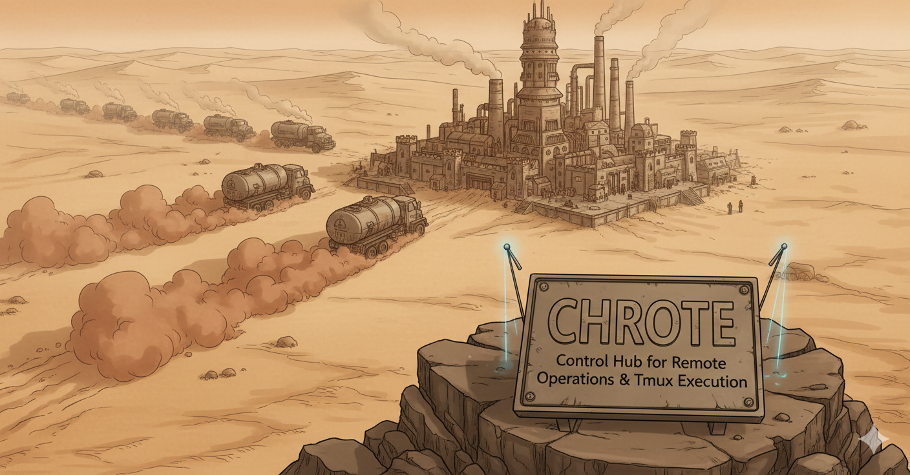

Terminal 1window 1 · empty

<h1 id="chrote-documentation">CHROTE documentation</h1>

Control Hub for Remote Operations and Tmux Execution. A browser-based agentic IDE for one trusted operator: see every tmux session on the host, arrange them side by side, and steer them from a laptop, tablet or phone on your own private network.

<ul class="start">
<li><a href="install.md">1 · InstallInstall CHROTEBuild from source and run it as a user service on Linux or WSL. No sudo.</a></li>
<li><a href="first-session.md">2 · LaunchYour first sessionLaunch an agent into a window, look at another with Peek, and hand it work.</a></li>
<li><a href="remote-access.md">3 · ReachReach it from your phoneKeep CHROTE on loopback and put HTTPS on your private network in front of it.</a></li>
<li><a href="concepts.md">LearnConceptsSessions, windows, tabs, Peek, Claim, residents and the table, in one page.</a></li>
<li><a href="configuration.md">ConfigureConfigurationWhere settings live, which survive a reinstall, and every variable.</a></li>
<li><a href="security.md">TrustSecurity modelNo login. Whoever reaches CHROTE holds a shell. Read this before exposing it.</a></li>
</ul>

## What CHROTE is

One agent in one terminal needs no dashboard. Ten agents across a dozen tmux
sessions is a different problem: you lose track of which one is waiting on an
answer, which one exited an hour ago, and which one has been rewriting the same
file since lunch. SSH and tmux handle that fine at a desk. They handle it badly
from a phone.

CHROTE puts handles on the work without taking it over. It shows the tmux
sessions on the host, arranges them into windows you watch side by side, and
lets you type into any of them. Close the browser, switch devices or restart
the server, and the sessions keep running, because the browser never owned
them.

Any command-line program runs in a CHROTE window: Codex, Claude Code, a build,
a log tail, `psql`. A window is a tmux session running your shell, and CHROTE
does not need to know which is which.

<pre class="diagram" role="img" aria-label="Diagram of the CHROTE workspace: a tab bar, the Sessions panel at the left, two terminal windows side by side, the table at the right and a resident's spine at the far right edge.">
<b>Terminal 1</b>  Terminal 2   Files   Beads   Brain   Agents   Scheduled   Services   Server   Settings
<i>──────────</i>───────────────────────────────────────────────────────────────────────────────────────────
┌ Sessions ────┐┌ api-refactor · claude ─────────┐┌ docs-pass · codex ──────────┐┌ The table ───┐┃
│ <i>●</i> api-refac… ││ › Running tests…               ││ › Rewrote install section.  ││ chrote-x1k   │┃
│   docs-pass  ││   42 passed, 1 failed          ││   Waiting for review.       ││ Fix reinstall│┃ C
│   build-log  ││                                ││                             ││ wording      │┃ L
│   psql       ││                                ││ ›                           ││              │┃ E
│ + Launch     ││ › <i>█</i>                            ││                             ││ Send  Alt+S  │┃ R
└──────────────┘└────────────────────────────────┘└─────────────────────────────┘└──────────────┘┃ K
</pre>

## How it fits together

- **tmux owns the sessions.** CHROTE discovers sessions on the tmux sockets it
  is configured to read, attaches to them on pseudo-terminals it allocates, and
  never falls back to another tmux server.
- **The host owns the work.** Files stay in the filesystem, issues in each
  project's Beads store, schedules and service catalogs in host configuration.
  CHROTE keeps no shadow copy.
- **The browser owns only presentation.** Layouts, tab labels and presets live
  in `localStorage`. Clear it and you lose an arrangement, never any work.
- **The network is the boundary.** There is no login. CHROTE binds to
  `127.0.0.1` and you reach it through a private network you control.

## Find your way

<ul class="rows">
<li><a href="terminals.md">UseTerminals, Send to Session, Files, Beads, Brain, Agents, Scheduled, Services, Server, Settings and the keyboard.</a></li>
<li><a href="environment.md">ConfigureThe environment reference, the launcher, the theme, the Library and residents, Services, and several Unix users.</a></li>
<li><a href="upgrade.md">OperateUpgrade, uninstall, troubleshoot, and know where state lives before you back it up.</a></li>
<li><a href="http-api.md">ReferenceThe HTTP routes, the development loop, and the canonical documents this site is built from.</a></li>
</ul>

CHROTE v2 is alpha. The canonical documents, such as
[`PRD.md`](../../../PRD.md), [`ARCHITECTURE.md`](../../../ARCHITECTURE.md) and
[`SECURITY.md`](../../../SECURITY.md), are rendered in this site under
[Source documents](documents.md). Where a guide page and a canonical document
disagree, the canonical document wins.
